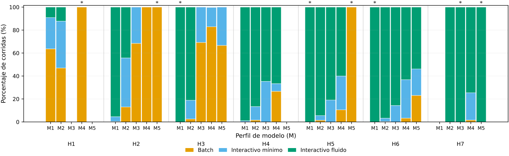

<!-- _class: lead -->
<!-- _paginate: false -->
<!-- _footer: "" -->

# Despliegue local de modelos de lenguaje en hardware heterogéneo
## Perfiles H×M e interactividad

**Matías Eduardo Bordone Carranza**

Grupo de PLN · FaMAF · Universidad Nacional de Córdoba
Directora: Dra. Laura Alonso Alemany · Inicio: ago. 2025

*Avance de investigación doctoral — Short paper · CACIC 2026*

<!-- _notes:
NOTAS (15 s). Buenas tardes, gracias por estar. Soy Matías Bordone, de FaMAF-UNC.
Esto es un avance de mi tesis doctoral, dirigida por Laura Alonso Alemany.
No digas disculpas ni "soy nuevo". Arrancá con energía.
Respirá y pasá rápido a la slide del problema.
-->

---

## El problema

Usar modelos de lenguaje **en la nube** tensiona tres dimensiones:

- **Privacidad** — los datos de trabajo no siempre pueden salir
- **Acceso** — costo por uso, límites de tokens, conectividad
- **Soberanía computacional** — delegás el control de infraestructura, datos y modelos

La **ejecución local** responde a eso… pero:

¿Qué modelo puedo correr <strong>en MI máquina</strong> y usarlo bien? Hoy no hay una guía sin ser técnico.

<!-- _notes:
NOTAS (1 min). El uso de LLMs como servicio en la nube tensiona privacidad,
acceso y soberanía. La ejecución local es una respuesta concreta.
Pero la frena el hardware heterogéneo y la falta de una guía.
Dato regional: casi la mitad de los adultos conectados en Argentina ya usa IA
generativa, de forma desigual. Ahí hay una brecha que este trabajo quiere achicar.
No te extiendas: el problema es el gancho, no el contenido.
-->

---

## Mi doctorado: 4 libertades del software libre → LLMs

| Libertad | Pregunta en IA |
|---|---|
| **0. Usar** | ¿Puedo ejecutarlo en mi hardware con la interactividad que necesito? |
| 1. Estudiarlo | ¿Tengo acceso a pesos, arquitectura, datos? |
| 2. Adaptarlo | ¿Puedo hacer fine-tuning en mi contexto? |
| 3. Compartirlo | ¿Puedo redistribuirlo con las mismas libertades? |

Hoy: <strong>Libertad 0</strong> — viabilidad de ejecución (si corre y con qué fluidez), <strong>no</strong> calidad de la salida.

<!-- _notes:
NOTAS (45 s). Mi tesis mira las 4 libertades del software libre aplicadas a la IA.
No voy a hablar de las cuatro: hoy es solo la Libertad 0, "Usar".
Y dentro de usar, un recorte clave: viabilidad de ejecución, no calidad del texto
que produce el modelo. Esa distinción importa: si alguien pregunta por calidad,
es trabajo futuro. Dejá esta slide rápido, es solo encuadre.
-->

---

## Pregunta de investigación

¿Qué modelos y configuraciones resultan adecuados para un <strong>perfil de hardware dado</strong> y un <strong>tipo de uso específico</strong>?

Tres perfiles de práctica que me orientan (**no son evidencia**):

- **Docentes** — datos sensibles, equipos sin GPU, uso en vivo
- **Investigadores en cs. sociales** — privacidad, hardware modesto
- **Desarrolladores** — distinta tolerancia a la espera

<!-- _notes:
NOTAS (30 s). Esta es la pregunta que ordena todo. Dado tu equipo y tu uso,
¿qué te conviene? Pensé en tres perfiles de práctica reales: docentes,
investigadores sociales, desarrolladores. Comparten datos sensibles y equipos
sin GPU dedicada. Aclaración honesta: orientan el estudio, no son el dato.
-->

---

## Datos: LocalScore

**Benchmark público** de inferencia local, comparable entre equipos.

- **3783 ejecuciones** (mar. 2025 – jun. 2026)
- **~1600 configuraciones únicas** de hardware
- Métrica primaria: **avg_gen_tps** (tokens/segundo de generación)

Una diversidad de hardware real <strong>inalcanzable en un laboratorio</strong>.

<!-- _notes:
NOTAS (1 min). La evidencia sale de LocalScore, un benchmark público: cada
usuario corre un modelo en su equipo y publica el resultado. Analicé 3783
corridas sobre casi 1600 configuraciones distintas. La fortaleza es esa:
diversidad real que no podría reunir en un lab. Uso la velocidad de generación
(tokens por segundo) como métrica, porque es lo que domina el tiempo percibido
cuando el texto llega en streaming. Guardá para preguntas: por qué gen y no TTFT.
-->

---

## El marco: perfiles H×M + interactividad

**H — hardware** (memoria): H0–H3 solo CPU/RAM · H4–H7 con GPU/VRAM  
**M — modelo** (parámetros): M1 <1B · M2 1–4B · M3 4–8B · M4 8–16B · M5 ≥16B

**Interactividad** (ligada a la velocidad de lectura en español, ~278 ppm):

| Régimen | Velocidad | Lo que sentís |
|---|---|---|
| **Batch** | < 10 tok/s | Esperás a que termine |
| **Interactivo** | 10 – 25 tok/s | Podés seguirlo, se nota la espera |
| **Fluido** | ≥ 25 tok/s | Aparece más rápido de lo que leés |

<!-- _notes:
NOTAS (1.5 min). El marco cruza dos ejes. H: clases de equipo por memoria,
desde CPU con poca RAM hasta GPU de servidor. M: modelos por tamaño.
Y la pieza propia: traducir tokens/segundo en experiencia. La lectura silenciosa
en español ronda 278 palabras por minuto; con eso, 10 tok/s ya va por encima de
la lectura promedio. Defino tres regímenes: batch, interactivo, fluido.
AQUÍ ADUEÑATE DE LA CRÍTICA: "son cortes operativos derivados de la velocidad
de lectura, NO validados con usuarios todavía — eso es trabajo futuro".
Decilo vos antes de que lo pregunten.
-->

---

<!-- _class: figure -->

## Resultado: viabilidad según H×M

**Dos patrones:** quiebre en **M4** (8–16B → batch sin GPU, fluido con GPU) · robustez de **M2** (1–4B → 97,4% interactivo sin GPU)

<!-- _notes:
NOTAS (2 min). ESTA ES LA SLIDE CLAVE. Tomate tu tiempo.
Mirá a la gente, señalá la figura. Dos patrones.
Uno: hay un quiebre en M4, los modelos de 8 a 16B. Sin GPU se van a batch
(82,9%); recién con GPU pasan a fluido.
Dos: los M2, de 1 a 4B, son robustos: con 16GB de RAM y sin GPU, el 97,4%
corre en régimen interactivo.
Conclusión operativa: dado tu hardware, el marco te dice qué tamaño aspira a
uso conversacional y cuál queda en batch. El asterisco marca celdas con pocas
corridas: no saques reglas de ahí.
-->

---

## El marco de decisión

Entrada: tu **perfil H** → salida: **M viable**, régimen esperado, advertencias.

| Perfil H | M recomendado | Régimen | Advertencia |
|---|---|---|---|
| H2–H3 (CPU, ≥8 GB) | M2 (1–4B) | Interactivo | M4 en batch sin GPU |
| H5–H6 (GPU 8–24 GB) | Hasta M4 (8–16B) | Fluido | M5 con cautela |

- Si la tarea **exige interacción** → fluido es el mínimo
- Si **tolera espera** → batch habilita modelos mayores
- Tensión: los modelos chicos (más fluidos) son también **más propensos a error**

<!-- _notes:
NOTAS (1 min). El marco toma tu perfil de hardware y devuelve qué tamaño es
viable, qué experiencia esperar y qué advertencias. Muestro solo dos filas,
las de mayor respaldo. La recomendación final depende del uso: si necesitás
interacción, pedí fluido; si tolerás espera, podés ir a modelos más grandes en
batch. Y una tensión importante: bajar de tamaño para ganar velocidad puede
aumentar el error. La elección no es solo velocidad, es riesgo tolerable.
-->

---

## Limitaciones y trabajo futuro

- **Cobertura desigual** — H0 y H4 (GPU <8 GB) tienen pocas corridas… y son los más comunes en contextos educativos de bajos recursos
- **Sesgo de selección** — quien corre LocalScore es usuario técnico con mejor hardware
- **Umbrales sin validar** — 10 y 25 tok/s salen de velocidad de lectura, no de usuarios
- **Falta TTFT** — la latencia inicial pesa con prompts largos (RAG)

Próximos pasos: incorporar TTFT, evaluar calidad y <strong>validar con usuarios reales</strong>.

<!-- _notes:
NOTAS (1 min). Soy explícito con los límites, es parte de la honestidad del
trabajo. Los dos revisores marcaron justo estos puntos, así que me los apropio:
uno, los perfiles de menos recursos (H0, H4) son los que menos datos tienen,
y son los que más me importan; por eso el próximo paso es una recolección
dirigida a esos grupos. Dos, los umbrales de interactividad hay que validarlos
con usuarios. Sumá TTFT y evaluación de calidad. Esto no es una debilidad
escondida: es mi agenda de tesis.
-->

---

<!-- _class: lead -->
<!-- _footer: "" -->

# Para llevarse una sola idea

Los modelos de **1–4B** ya sirven para uso conversacional **sin GPU** (con ≥16 GB RAM).  
Los de **8–16B** necesitan **GPU**.  
Con **3783 corridas reales**, no de laboratorio.

**¡Gracias!** · mebordone@unc.edu.ar

*Datos y código: github.com/mebordone/localscore-analisis*

<!-- _notes:
NOTAS (cierre + preguntas). Repetí el mensaje central, despacio.
Si te quedaste sin tiempo, saltá directo acá desde la figura.
Invitá a preguntas con calma. Ante crítica: agradecé y anotá, no te defiendas.
Mencioná el repo: ciencia abierta es parte de tu identidad.

PREGUNTAS PROBABLES:
- Calidad de salida: acoté a viabilidad; calidad es eje separado, trabajo futuro.
- Umbrales arbitrarios: derivados de lectura en español; falta validar, lo asumo.
- Sesgo LocalScore: sí, lo discuto; por eso recolección dirigida es el paso.
- ¿Cambia con cada modelo nuevo?: el marco es por tamaño y hardware, no por
  modelo puntual; 87% usa Q4, así que las bandas se sostienen.
- ¿Por qué gen_tps y no TTFT?: gen domina el tiempo percibido en streaming;
  TTFT es limitación reconocida y trabajo futuro.
-->
