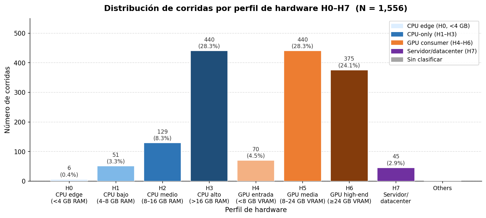
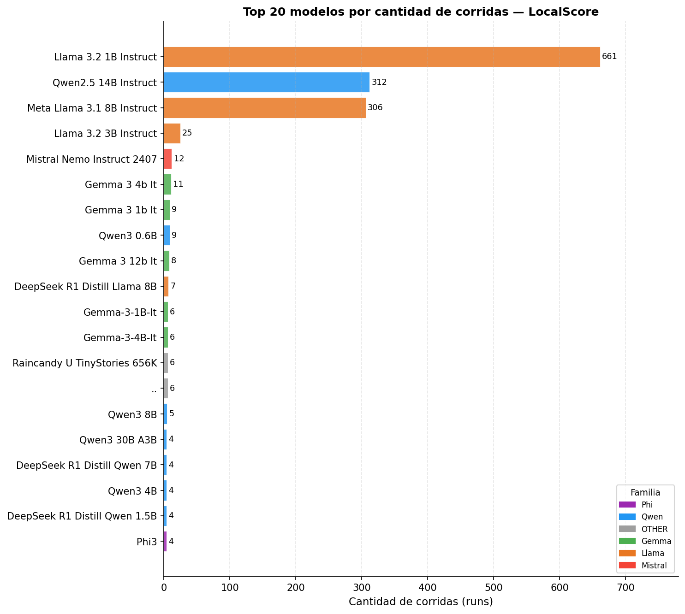
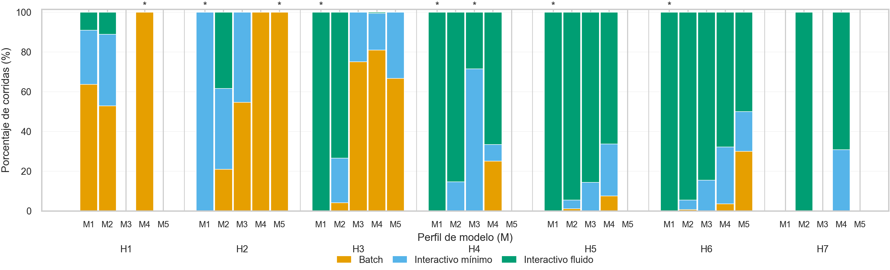

<!-- _class: lead -->

# ¿Puedo ejecutar IA en mi compu?
## IA libre para hardware choto

**FLISoL Córdoba 2026**
Matías Bordone — Aula 1 · 12:00 hs

*Licenciado en Cs. de la Computación · Doctorando · Docente*
*Cybercirujas · LibreBase · Vía Libre*

<!-- _notes:
BLOQUE 1 — GANCHO (3 min)

Arrancar sin apuros. Mirar al público.
Presentarse brevemente: "trabajo en IA hace años, investigo despliegue local para mi doctorado, y también soy uno de ustedes porque uso Linux y me interesan las mismas cosas que a ustedes."
La combinación del título genera expectativa: ¿va a decir que sí o que no?
-->

---

## Vivimos en el año de la IA

Todo el mundo habla de IA.

Tu jefe quiere "implementar IA". Tu docente pregunta si lo hiciste con IA.  
Tu dentista tiene un cartel que dice "usamos IA".

Y hay razones para tomárselo en serio:

- **Redacción y síntesis** de documentos largos
- **Análisis** de texto, código, datos
- **Asistencia** en tareas repetitivas o técnicas
- **Accesibilidad**: explicar cosas complejas en lenguaje simple

Muchas de esas promesas son reales. El problema es otro.

<!-- _notes:
BLOQUE 1 — GANCHO (sigue)

Tomarse 30 segundos con esta slide. No es para reírse de la IA, es para validar que el entusiasmo tiene base.
"El problema no es que la IA no sirva. El problema es cómo y dónde corre."
-->

---

## El modelo de negocio que nadie te explica

Cuando usás ChatGPT, Gemini o Claude en la nube:

<div class="columns">
<div>

### Lo que te dan
- Acceso fácil
- Modelos potentes
- Interfaz linda

</div>
<div>

### Lo que se quedan
- **Tus datos** (documentos, código, consultas)
- **Control** sobre el modelo y la infraestructura
- **Acceso futuro**: ¿cuánto va a costar el año que viene?

</div>
</div>

Y además:

- **Necesitás internet** siempre
- **Límites de tokens** según el plan
- **Vos no podés auditar** nada de lo que pasa adentro

<!-- _notes:
BLOQUE 1 — GANCHO (sigue)

No ponerse apocalíptico. Estos son trade-offs reales, no conspiraciones.
Conectar con el público: "si trabajás con datos de estudiantes, código propietario, o transcripciones de investigación, estas tensiones son muy concretas."
-->

---

## Tres tensiones que me interesan especialmente

<div class="columns3">
<div class="card">

### 🔒 Privacidad
Datos de estudiantes, código propietario, transcripciones de investigación.
No siempre podés mandárselos a una empresa en California.

</div>
<div class="card">

### 🌐 Acceso
Costo por uso, límites de tokens, dependencia de conectividad.
¿Funciona en una escuela rural con internet intermitente?

</div>
<div class="card">

### 🏛️ Soberanía
¿Quién controla el modelo, los datos, la infraestructura?
Universidades e instituciones que delegan todo eso.

</div>
</div>

Y uno más, más silencioso:

> **Tenés hardware propio. Probablemente lo estés subutilizando.**

<!-- _notes:
BLOQUE 1 — GANCHO (cierre)

El cuarto punto conecta con Cybercirujas y la audiencia de FLISoL: muchos tienen máquinas que "solo hacen el trabajo mínimo" cuando podrían hacer más.
Pausa breve acá antes de la siguiente slide.
-->

---

<!-- _class: dark -->

## La respuesta que ya existe: IA local con pesos abiertos

Hay modelos de lenguaje con **pesos abiertos** que podés:

- **Descargar** a tu máquina
- **Ejecutar** sin depender de ninguna API externa
- **Usar** sin que nadie se quede con tus datos
- **Auditar**, modificar, redistribuir

Ejemplos: **Llama** (Meta), **Mistral**, **Qwen** (Alibaba), **Gemma** (Google), **Phi** (Microsoft)...

Muchos con licencias que permiten uso comercial.
No todos son "software libre" en sentido estricto: conviene revisar la licencia de cada familia.

Pero hay una trampa.

<!-- _notes:
BLOQUE 2 — LA SOLUCIÓN QUE EXISTE (2 min)

"Existe una respuesta. No es perfecta, pero existe."
El "pero hay una trampa" es el gancho para el siguiente bloque.
No detenerse mucho acá: esta slide es un puente.
Si sale la pregunta de licencias: aclarar "open weights/local" y no afirmar libertad total en todos los casos.
-->

---

<!-- _class: demo -->

## Demo: LM Studio

Antes de hablar del problema, les muestro que **funciona hoy**.

LM Studio es una aplicación de escritorio (Linux/Mac/Windows) que permite:

- Descargar modelos desde Hugging Face con un clic
- Ejecutarlos localmente
- Chatear con ellos, pasarles archivos, configurarlos

**Lo que voy a mostrar:**

1. Descargar y cargar un modelo
2. Preguntarle algo con texto libre
3. Pasarle un PDF (RAG local)
4. Reconocimiento de imagen
5. Herramientas vía MCP — mi Thunderbird conectado al modelo

<!-- _notes:
BLOQUE 3 — DEMO LM STUDIO (6 min)

Esta es la demo más importante. Establece credibilidad: "esto no es teórico, corre ahora en mi compu."
Elegir un modelo que responda rápido para la primera impresión. Probablemente Qwen3:8b o similar.
Para el MCP de Thunderbird: mostrarlo brevemente, no extenderse.
Si algo sale mal: "esto también es parte del punto — no siempre es plug and play."
TIEMPO: no pasar de 6 minutos. Si la demo va bien, cortar antes.
PLAN B: tener una captura y una salida ya corrida (prompt + respuesta + archivo cargado) para mostrar en 30 segundos.
-->

---

## ¿Para quién sirve esto?

Hablé con personas de tres perfiles concretos:

<div class="columns3">
<div class="card">

### 🎓 Docentes
Planificación, materiales, consultas frecuentes, apoyo con bibliografía.
**Datos sensibles**: información de estudiantes que no puede salir de la institución.

</div>
<div class="card">

### 🔬 Investigadores sociales
Transcripción, análisis cualitativo, trazabilidad del proceso.
**Datos sensibles**: entrevistas, testimonios, material de campo.

</div>
<div class="card">

### 💻 Desarrolladores / SREs
Refactors, migraciones, documentación, diagnóstico en vivo.
**Datos sensibles**: código propietario, infraestructura interna.

</div>
</div>

Los tres tienen algo en común: **privacidad y soberanía no son preferencias ideológicas, son requisitos operativos.**

<!-- _notes:
BLOQUE 4 — LOS TRES PERFILES (5 min)

Hablar despacio acá. La audiencia mixta se va a identificar con alguno de estos perfiles.
Si hay alguien del público que levantó la mano o preguntó antes, relacionarlo.
El punto final sobre privacidad como "requisito operativo" y no "preferencia ideológica" es importante para no perder a quienes vienen por la parte técnica.
-->

---

## Lo que cada perfil necesita del modelo

<div class="columns">
<div>

**Docente** — tolerancia al error baja en evaluación, puede esperar para materiales, necesita respuestas conversacionales en clase

**Investigador social** — alucinación bibliográfica es un error crítico, hardware del campo generalmente limitado (8 GB RAM, sin GPU)

**Desarrollador / SRE** — iteración rápida para diagnóstico, acepta batch para tareas largas, alta sensibilidad por código propietario

</div>
<div>

Esto se traduce en demandas concretas:

| Práctica | ¿Necesita interactividad? |
|----------|--------------------------|
| Consulta en clase | **Sí, fluida** |
| Producción de materiales | No urgente |
| Análisis de transcripciones | No urgente |
| Diagnóstico de infra | **Sí, rápida** |
| Migración de código | Puede esperar |

</div>
</div>

<!-- _notes:
BLOQUE 4 — LOS TRES PERFILES (cierre)

Esta tabla es el puente conceptual: conecta "quién usa" con "qué necesita del modelo".
No leer la tabla entera. Señalar una o dos filas y explicar la idea.
-->

---

<!-- _class: callout -->

## El problema real

> No alcanza con que el modelo **exista** en tu compu.
> La pregunta es si va a ser **usable**.

Hay una diferencia entre:

- Un modelo que **corre** (no tira error, genera texto)
- Un modelo que **podés usar** de forma fluida para tu tarea

Esa diferencia la determina tu hardware.

<!-- _notes:
BLOQUE 5 — EL PROBLEMA REAL (2 min)

Esta slide es el giro conceptual más importante. Darle espacio.
"Usable no es lo mismo que ejecutable."
Pausa después de leer la cita. Dejar que caiga.
-->

---

<!-- _class: demo -->

## ¿Cómo sabemos si mi hardware lo aguanta?

Para eso existe **LocalScore**.

Es un benchmark open source (proyecto de **Mozilla Builders**) que:

- Ejecuta un modelo en **tu hardware específico**
- Mide cuántos tokens por segundo genera
- Publica los resultados en una **base pública** para comparar equipos

Tres métricas principales:

| Métrica | Qué mide |
|---------|----------|
| `avg_prompt_tps` | Velocidad de procesamiento del prompt (lo que le mando, texto, imagen, documento)|
| `avg_gen_tps` | Velocidad de generación de texto de respuesta|
| `avg_ttft_ms` | Tiempo hasta el primer token de respuesta|

Para esta charla me centro en **`avg_gen_tps`**: es lo que sentís cuando el modelo te responde.

<!-- _notes:
BLOQUE 6 — LOCALSCORE (5 min)

Explicar que LocalScore es público y reproducible: los datos que voy a mostrar son de la misma herramienta que ellos pueden ejecutar.
Aclarar que avg_gen_tps es "la velocidad a la que ves el texto aparecer en pantalla."
-->

---

<!-- _class: demo -->

## Demo: ejecutar LocalScore

Tres comandos. Sin configuración. (Descargar de https://www.localscore.ai/download)

**Opción 1 — modelo oficial incluido (recomendado para empezar):**

```bash
curl -OL https://localscore.ai/download/localscore-tiny
chmod +x localscore-tiny
./localscore-tiny
```

Incluye Llama 3.2 1B. Requiere ~2 GB de RAM. Tarda unos minutos.

**Opción 2 — con tus propios modelos `.gguf`:** (podés descargarlos con Lmstudio o de Hugging Face)

```bash
./localscore-0.9.3 -m path/to/tu-modelo.gguf
```

**Al terminar:** te muestra el resultado y te pregunta si querés publicarlo en [localscore.ai](https://localscore.ai).

*(También hay versión para Windows: `localscore-0.9.3.exe`)*

<!-- _notes:
BLOQUE 6 — LOCALSCORE DEMO (sigue)

Mostrar la ejecución en vivo si es posible. Si ya está corriendo desde antes, mostrar el resultado.
El momento de publicar el resultado es importante: es el llamado a contribuir hecho concreto.
Si el público tiene laptops: "si tienen una máquina con ellos, lo pueden ejecutar ahora mismo."
PLAN B: mostrar output pre-ejecutado y seguir con resultados; no quedarse esperando la corrida.
-->

---

## Analicé 1.556 ejecuciones de LocalScore

Descargué un dump público del benchmark (septiembre 2025).

**¿Qué hardware había?**



*La muestra se concentra en perfiles medios/altos. Los extremos (muy poca RAM o GPU baja) tienen menos datos — y son los más relevantes para el público de esta charla.*

<!-- _notes:
BLOQUE 7 — MI ANÁLISIS (5 min)

Señalar la asimetría: tenemos más datos de las máquinas "buenas" que de las máquinas que más nos importan.
Eso también es un resultado del estudio y un motivo para pedir que más gente ejecute LocalScore.
-->

---

## ¿Qué modelos habían corrido?

<div style="display:grid; grid-template-columns: 0.85fr 1.15fr; gap: 28px; align-items:center;">
<div>

Dos patrones importantes:

- **87% de las corridas usaron Q4\_K\_Medium** como cuantización → el efecto que vemos es sobre todo de tamaño del modelo y hardware, no de cuantización
- Concentración en pocas familias de modelos

</div>
<div>



</div>
</div>

<!-- _notes:
BLOQUE 7 — MI ANÁLISIS (sigue)

Explicar brevemente que cuantización = comprimir el modelo para que ocupe menos memoria.
"Como si guardáramos el modelo en formato lossy — perdemos un poco de precisión, ganamos mucho en tamaño."
El punto sobre Q4 como dominante es importante para no oversell la generalización.
-->

---

## ¿Cómo traduzco "tokens por segundo" a experiencia?

Usé la velocidad de lectura silenciosa en español como referencia.

Según **Brysbaert et al. (2019)**: el promedio es **278 palabras por minuto**.

En español, 1 palabra ≈ 1,7 tokens. Entonces:

> Si el modelo genera a **10 tok/s**, ya estás recibiendo texto a ~350 palabras por minuto — más rápido de lo que leés.

Con eso definí tres categorías:

| Categoría | Velocidad | Lo que sentís |
|-----------|-----------|---------------|
| **Batch** | < 10 tok/s | Esperás a que termine. No conversacional. |
| **Interactivo mínimo** | 10–25 tok/s | Podés seguirlo, pero se nota la espera. |
| **Interactivo fluido** | ≥ 25 tok/s | La respuesta aparece más rápido de lo que leés. |

*Son umbrales operativos, no estándares validados. Pero permiten anticipar la experiencia antes de descargar.*

<!-- _notes:
BLOQUE 7 — MI ANÁLISIS (cierre)

Este es el aporte conceptual más importante del paper y de la charla.
"La idea no es inventar un estándar. Es que tengan una manera de anticipar qué van a sentir antes de descargar 4 GB."
Hacer la pregunta retórica: "¿alguien probó un modelo que iba muy lento? Eso era batch."
-->

---

## El gráfico principal



*Cada barra muestra el % de corridas en cada régimen (fluido / mínimo / batch) para una combinación hardware × tamaño de modelo.*

<!-- _notes:
BLOQUE 8 — RESULTADOS (4 min)

No apurar esta slide. Dar 30 segundos para que el público la lea.
Luego señalar los dos patrones que se explican en la siguiente slide.
RECORTE SI FALTA TIEMPO: mostrar solo esta slide y pasar directo a "El framework".
-->

---

## Dos patrones que aparecen con claridad

<div class="columns">
<div>

### CPU sola + modelos medianos/grandes
→ **Batch dominante**

Ejemplo concreto: H3 (≥16 GB RAM, sin GPU) + M4 (8–16B parámetros)

- **80,9%** de esas corridas caen en batch
- No es que no corra: es que no es conversacional

</div>
<div>

### GPU media/alta + modelos medianos
→ **Interactivo fluido**

Ejemplo concreto: H5 (8–24 GB VRAM) + M4

- **66,4%** de esas corridas son fluidas
- El mismo modelo, hardware diferente, experiencia diferente

**M2 (1–4B) es el punto dulce en CPU:**
H3+M2 alcanza 96% interactivo total, 73,5% fluido.

</div>
</div>

<!-- _notes:
BLOQUE 8 — RESULTADOS (sigue)

Estos números vienen directo del paper. Son los más robustos de la muestra.
"El modelo no cambió. Lo que cambió fue el hardware debajo."
Conectar con los perfiles: la docente con H2 (8 GB sin GPU) encaja en el patrón de la izquierda para modelos grandes.
-->

---

## El framework: dado tu hardware, ¿qué modelo probás?

<br>

| Perfil hardware | Modelos recomendados | Régimen esperado | Ojo con... |
|-----------------|---------------------|-----------------|------------|
| **H0–H1** (< 8 GB RAM, CPU) | M1; M2 con cuidado | Batch a interactivo mínimo | Datos escasos en la muestra |
| **H2–H3** (8–16+ GB RAM, CPU) | **M2** (1–4B) | Interactivo (fluido en H3) | M4 cae en batch sin GPU |
| **H4** (< 8 GB VRAM) | M2 (1–4B) | Interactivo fluido | Poca cobertura en la muestra |
| **H5–H6** (8–24+ GB VRAM) | Hasta **M4** (8–16B) | Interactivo fluido | M5 requiere cautela |
| **H7** (servidor/datacenter) | Todos | Fluido | Concurrencia no evaluada |

<br>

*La tabla indica viabilidad técnica. La recomendación final depende también del tipo de uso y del costo del error.*

<!-- _notes:
BLOQUE 9 — EL FRAMEWORK (4 min)

No leer toda la tabla. Señalar dos o tres filas y contar la historia.
"Si sos docente con una laptop de 8 GB sin GPU: M2 es tu zona. M4 va a ir lento."
"Si tenés una GPU media en tu homelab: M4 se vuelve viable y la experiencia cambia mucho."
RECORTE SI FALTA TIEMPO: saltear "Cómo usarlo en la práctica" y pasar a "Lo que necesito de ustedes".
-->

---

## Cómo usarlo en la práctica

<div class="columns3">
<div class="card">

### Caso 1
**8 GB RAM, sin GPU** *(docente, investigador típico)*

→ Probá primero **M2** (1–4B)
→ Esperá interacción fluida o media
→ Si la tarea puede esperar, podés intentar M3

</div>
<div class="card">

### Caso 2
**GPU media o alta** *(developer, homelab)*

→ Podés considerar **M4** (8–16B)
→ La experiencia probablemente sea fluida
→ Revisá si el modelo entra en VRAM con tu cuantización

</div>
<div class="card">

### Caso 3
**Tarea sensible o crítica**

→ No importa qué modelo uses
→ **Verificación humana siempre**
→ El modelo asiste, no decide

</div>
</div>

<!-- _notes:
BLOQUE 9 — EL FRAMEWORK (cierre)

Esta slide es para que el público salga con algo concreto.
"Si se llevan una sola cosa de esta charla: sabés tu hardware, sabés qué rango de modelo tiene sentido intentar primero."
-->

---

<!-- _class: dark -->

## Lo que necesito de ustedes

El estudio tiene una limitación grande: **la muestra está sesgada hacia hardware bueno**.

Las zonas con menos datos son exactamente las que más me interesan:

- **H0–H1**: CPU con menos de 8 GB RAM ← la laptop promedio de un docente
- **H4**: GPU vieja con menos de 8 GB VRAM ← la GTX 1060 de un investigador

**¿Cómo ayudar?**

```bash
# En Linux/Mac — tarda unos minutos:
curl -OL https://localscore.ai/download/localscore-tiny
chmod +x localscore-tiny
./localscore-tiny
```

Al terminar, publicá el resultado en **localscore.ai**.

Si tenés modelos `.gguf` propios, ejecutalo con ellos también.

Cada corrida que publicás llena un hueco en el dataset.

<!-- _notes:
BLOQUE 10 — LLAMADO A LA COMUNIDAD (3 min)

Este es el momento más importante de la charla si el objetivo es que salgan queriendo contribuir.
Ser específico: "si tienen una máquina con ellos, lo pueden ejecutar ahora, durante las preguntas o cuando vuelvan a casa."
Mencionar el repo del paper si está disponible.
-->

---

## Lo que falta (y por qué importa)

Cuatro limitaciones del trabajo actual:

**1. Cobertura desigual** — pocas corridas en H0–H1 y H4, justo los perfiles más frecuentes en educación e investigación en Argentina.

**2. Sesgo de selección** — quien usa LocalScore probablemente tiene buen hardware y perfil técnico. No es representativo del campo.

**3. Umbrales no validados empíricamente** — los 10 y 25 tok/s vienen de la velocidad de lectura, no de experimentos con usuarios reales. Son un punto de partida operativo.

**4. Alcance cualitativo** — tres entrevistas son suficientes para explorar, no para generalizar.

Estas limitaciones no invalidan el marco. Lo hacen una **base para seguir midiendo**, con más datos y más perfiles.

<!-- _notes:
BLOQUE 11 — LIMITACIONES (2 min)

Ser directo y sin defensas. La madurez metodológica es mostrar que uno sabe qué falta.
"El trabajo es preliminar. Por eso el llamado a contribuir no es opcional: es parte del método."
-->

---

<!-- _class: lead -->

## La idea central

<br>

> No toda IA abierta corre igual de usable en cualquier máquina.
> Pero podemos aprender a decidir mejor qué correr en cada hardware.

<br>

**Antes de descargar un modelo:**
→ Sabé tu perfil de hardware (RAM, VRAM o sin GPU)
→ Cruzalo con el rango M que corresponde
→ Ejecutá LocalScore para verificar en tu máquina específica

<br>

*Repositorio (paper + notebooks): [github.com/mebordone/localscore-analisis](https://github.com/mebordone/localscore-analisis)*
*Cualquier pregunta — ahora o después: **mebordone@gmail.com***

**¡Gracias!** 🙌

<!-- _notes:
BLOQUE 12 — CIERRE (2 min)

Cerrar con calma. No apurarse.
Agradecer genuinamente.
Dejar el mail y el repo visible mientras arranca la ronda de preguntas.
Si hay tiempo: "¿Alguien tiene una laptop acá y quiere ejecutar LocalScore en vivo?"
-->